# Installation Guide

This guide takes you from nothing to watching your first movie in Plex or Jellyfin. You run
one Docker container, then the bridge's **Setup** tab gives you a command to paste on each
other machine. Plan on about 15 minutes.

**Before you start, read [Activate a few titles at a time](#7-first-sync-and-activate):** each
activation and each Plex/Jellyfin scan of a new title uses a Dispatcharr connection slot.

## 0. What you're building

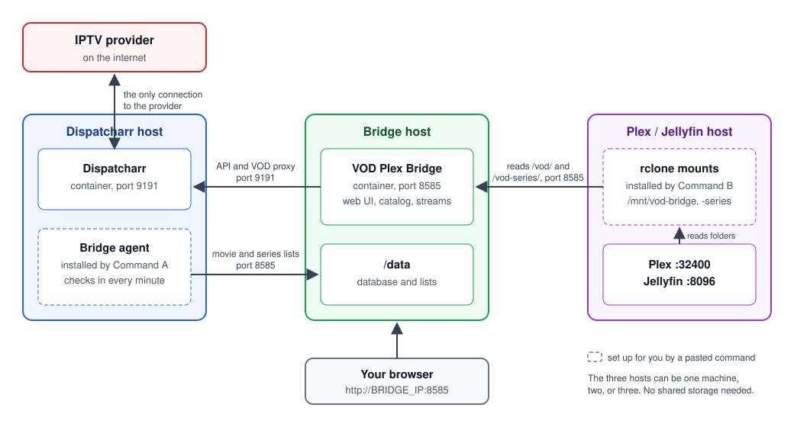

- **Dispatcharr** already manages your IPTV accounts. It is the only thing that talks to your
  provider.
- **VOD Plex Bridge** (this project) catalogs the movies and series, lets you pick which ones
  to add, and streams them through Dispatcharr when you press play.
- **Plex or Jellyfin** sees the movies you picked as ordinary folders. A small **rclone** mount
  on that machine reads them from the bridge over HTTP.

The three can share one machine or sit on three. No shared storage (NFS/CIFS) is needed.
Plex/Jellyfin only needs to reach the bridge on port 8585, and the bridge needs to reach
Dispatcharr on port 9191.

---

## 1. Before you start

- [ ] **Dispatcharr** running, with at least one M3U account that has VOD content
- [ ] A **Dispatcharr API key** (in Dispatcharr: Settings → API Keys → Generate)
- [ ] **Plex** and/or **Jellyfin** running. For Plex you also need a
      [Plex token](https://support.plex.tv/articles/204059436/)
- [ ] **Docker** with Compose on the machine that will run the bridge
- [ ] **Shell access with sudo** on the Dispatcharr machine and on each Plex/Jellyfin machine
- [ ] *(Optional)* A free [TMDB API key](https://www.themoviedb.org/settings/api) for posters,
      genres and descriptions

The commands the bridge gives you are tested on **Linux and Proxmox LXC** (anything with
systemd). Unraid, Windows, macOS and NAS boxes get written-out steps instead. See
[Platform notes](#platform-notes).

---

## 2. Install the bridge

On the machine that will run the bridge, make a folder with two files in it.

**`docker-compose.yml`**

```yaml
services:
  vod-plex-bridge:
    image: ghcr.io/knmplace/vod-plex-bridge:latest
    container_name: vod-plex-bridge
    restart: unless-stopped
    ports:
      - "8585:8585"
    env_file:
      - .env
    environment:
      - TZ=America/New_York
      - DB_PATH=/data/vod_bridge.db
      - CATEGORY_MAPPING_FILE=/data/category_mapping.json
      - STREAM_MAPPING_FILE=/data/stream_mapping.json
      - STRM_OUTPUT_DIR=/plex-vod/Movies
    volumes:
      - ./data:/data
      - ./plex-vod:/plex-vod
```

**`.env`**

```bash
# The LAN address of THIS machine. Not 0.0.0.0, 127.0.0.1 or localhost.
BRIDGE_HOST=192.168.1.20

# Any long random string. Encrypts the API keys and tokens you save in Settings.
# Make one with:  openssl rand -base64 32
# Keep a copy somewhere safe; if it is lost, saved keys must be entered again.
SETTINGS_KEY=paste-a-long-random-string-here
```

That's all `.env` needs. Everything else (Dispatcharr, Plex, TMDB) is entered in the app.
The full list of optional variables is in [.env.example](.env.example).

Start it:

```bash
docker compose up -d
docker compose logs -f     # wait for "Uvicorn running on http://0.0.0.0:8585", then Ctrl+C
```

> Prefer to build from source? Clone the repo, copy
> [docker-compose.example.yml](docker-compose.example.yml) to `docker-compose.yml`, and swap its
> `image:` line for the commented `build: .` line.

---

## 3. First sign-in and the Setup tab

Open `http://BRIDGE_IP:8585` in a browser. The first visit asks you to **create the admin
account**. After that, every page needs a sign-in, apart from the paths rclone and Plex use
(`/vod/`, `/vod-series/`, `/stream/`) and the setup links described below.

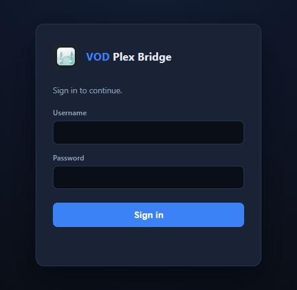

Next, open **Settings** and fill in these sections, pressing **Test** on each one:

- **Dispatcharr**: its address (for example `http://192.168.1.20:9191`) and the API key
- **Plex**: the address (for example `http://192.168.1.30:32400`) and the token. Leave the
  library ID empty; step 6 fills it in.
- **TMDB**: the key, if you have one

The **Setup** tab opens by itself on first sign-in. It has five steps. Each step has a light
that turns green when the bridge confirms the step worked.

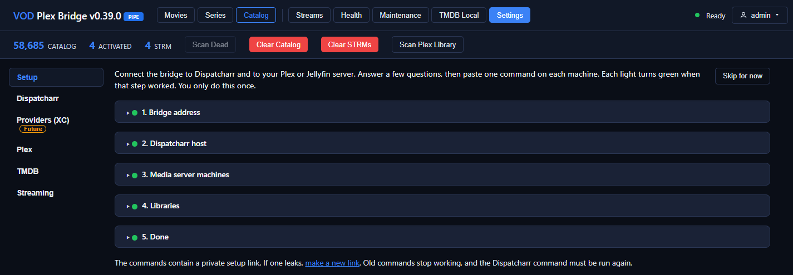

**Step 1, Bridge address.** This is the address your other machines use to reach the bridge,
including the port. It is filled in for you from `BRIDGE_HOST`. Check it and press **Save**.

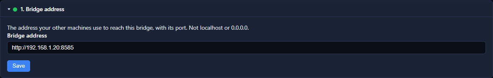

> **Skip for now** hides the Setup tab's auto-open if you set everything up by hand. You can
> come back to the tab at any time.

---

## 4. The Dispatcharr machine: Command A

The bridge needs Dispatcharr's movie and series lists, which only Dispatcharr's own database
holds. Command A installs a small agent on the Dispatcharr machine that sends them over.

1. Open **Setup → 2. Dispatcharr host**.
2. Copy the command shown under **"Paste this on the Dispatcharr host:"**.
3. Paste it into a shell on the machine where the Dispatcharr container runs.

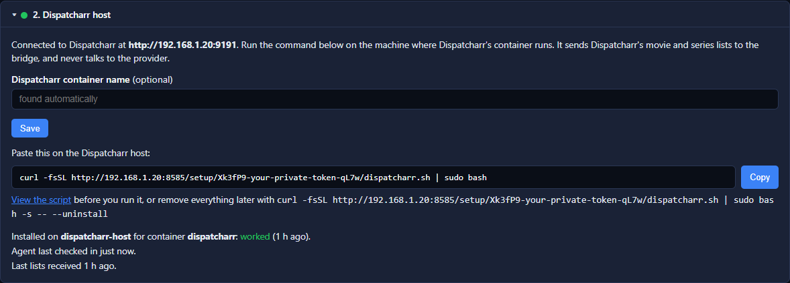

The command looks like this, with your bridge address and your own private link:

```bash
curl -fsSL http://192.168.1.20:8585/setup/<your-private-link>/dispatcharr.sh | sudo bash
```

When it finishes it prints **"All set. Go back to the Setup tab; the Dispatcharr light should
be green."** Within a minute the light turns green and the step shows when the last lists
arrived.

**What Command A does**

- Finds the running Dispatcharr container. It stops and asks if it finds none, or more than
  one.
- Installs its files in `/opt/vod-plex-bridge/` and one schedule file,
  `/etc/cron.d/vod-plex-bridge`:
  - every minute it asks the bridge whether fresh lists are wanted (the 6:00 AM Daily Run and
    **Run Now** ask for them)
  - every 12 hours it sends fresh lists anyway
- Sends the first lists straight away, so the Catalog tab fills on the first run.
- If you followed an older version of this guide, it tells you about the old cron lines it
  found. Remove those with `crontab -e`; it never edits your crontab itself.

The lists contain movie, series and category IDs plus provider account names. They contain
no passwords or provider logins.

---

## 5. The Plex / Jellyfin machine: Command B

Command B installs rclone on the machine that runs Plex or Jellyfin, and mounts the bridge's
movies and series there as ordinary folders.

Open **Setup → 3. Media server machines**. Each machine gets its own card. Press **Add machine**
for a second one, for example when Plex and Jellyfin live on different hosts.

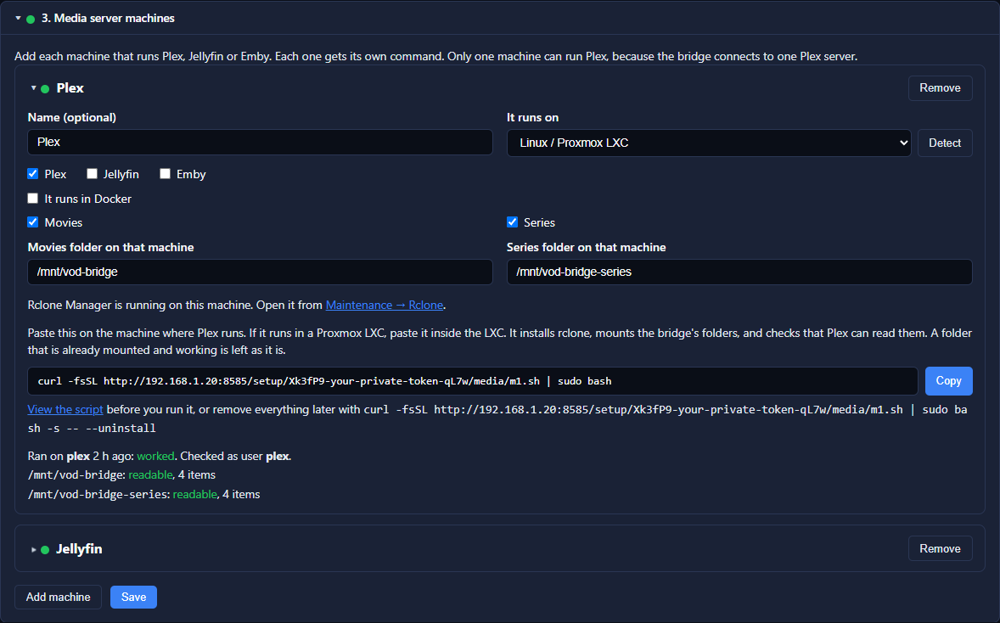

Fill in the card:

| Field | What to put |
|---|---|
| **Name** | Anything that helps you tell machines apart, like "Plex" |
| **It runs on** | Linux / Proxmox LXC, Unraid, Windows, macOS, or Synology / QNAP / other NAS. **Detect** asks Plex. |
| **Servers** | Tick Plex, Jellyfin and/or Emby, whichever run on this machine |
| **It runs in Docker** | Tick it if the media server is a container, and type the container name |
| **Movies / Series** | What this machine should mount |
| **Movies folder / Series folder** | Defaults are `/mnt/vod-bridge` and `/mnt/vod-bridge-series` |
| **Also install Rclone Manager** | Optional web page for checking and restarting the mounts. See the note below. |

> **Decide on Rclone Manager before you run Command B.**
> Tick **"Also install Rclone Manager, a web page for checking and restarting the mounts"**
> on the card *first*, press **Save**, and *then* copy and run Command B. Command B is what
> installs Rclone Manager and reports it back to the bridge, and that report is what adds the
> machine to **Maintenance → Rclone** and the link on the Health tab.
> If you tick it after you've already run Command B, press **Save** and run Command B again
> on that machine. Running it again is safe; anything already working is left alone.

Press **Save**, then copy the command shown on the card and paste it on that machine:

```bash
curl -fsSL http://192.168.1.20:8585/setup/<your-private-link>/media/m1.sh | sudo bash
```

**What Command B does**

1. **Checks first** and stops with a clear message if something is missing: it must run as
   root, on Linux with systemd, with `curl`, the bridge reachable and `/dev/fuse` present.
   - **Proxmox LXC without FUSE:** on the Proxmox host run
     `pct set <container id> --features fuse=1` (keep any features already set, for example
     `--features nesting=1,fuse=1`), then restart the container and run Command B again.
2. **Installs** rclone (official installer, skipped if present) and FUSE, and turns on
   `user_allow_other` in `/etc/fuse.conf` so the `plex` / `jellyfin` user can read the mount.
3. **Adds two remotes**, `vodbridge-movies` and `vodbridge-series`, to your normal
   `rclone.conf`. It backs the file up first and never touches other remotes.
4. **Creates and starts two services**, `rclone-vod-bridge-movies.service` and
   `rclone-vod-bridge-series.service`. They start on boot and restart if they fail.
5. **Respects older mounts** from a hand-made setup (for example `rclone-vod.service` or
   `rclone-vodbridge.service`). If one already mounts the same folder and works, it is left
   as it is. If it's there but broken, the script shows it and asks **y/N** before replacing
   it. A replaced unit is kept as `<name>.replaced-by-vod-bridge`. To swap working old mounts
   for the bridge's own, run the command with `| sudo bash -s -- --replace`.
6. **Asks for a Rclone Manager password** if you ticked it. Leave it blank to keep the default
   `ChangeMeNow!`, and change it on first sign-in.
7. **Checks the mounts** as the Plex/Jellyfin user, then reports back. The light on the card
   turns green.

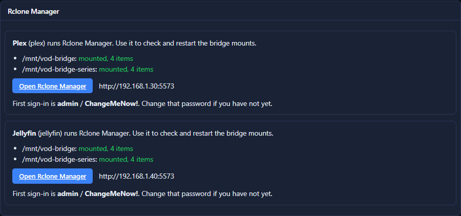

### Plex or Jellyfin in Docker

The mount is made on the **host**. The container needs to see it, so add these lines to the
container's volumes (the card shows the exact lines for your folders):

```yaml
    volumes:
      - /mnt/vod-bridge:/mnt/vod-bridge:ro,rslave
      - /mnt/vod-bridge-series:/mnt/vod-bridge-series:ro,rslave
```

**Mount first, then recreate the container.** Run Command B, check `ls /mnt/vod-bridge` on the
host, and only then recreate the container (in Portainer: edit the stack → Update, or
`docker compose up -d`). `rslave` lets the container see the mount if it restarts later.
Command B never edits your compose files or stacks.

---

## 6. Create the libraries

Open **Setup → 4. Libraries**.

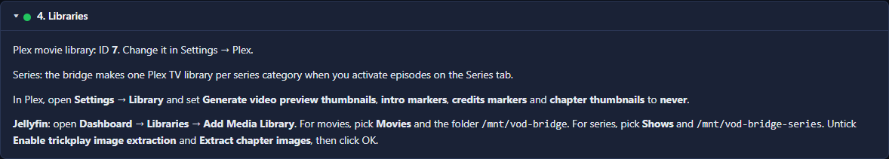

### Plex: the bridge does it

1. Enter a **Library name** (default "Bridge Movies") and press **Create Plex movie library**.
   The bridge creates a Movies library at the movie folder from your Plex machine's card,
   saves its ID in **Settings → Plex**, and turns off preview thumbnails and credits detection
   for it.
2. **Series** need no step here. When you activate episodes on the Series tab, the bridge
   creates one Plex TV library per series category, under the series folder.
3. In Plex, open **Settings → Library** and set these to **never**:
   - Generate video preview thumbnails
   - Generate intro video markers
   - Generate credits video markers
   - Generate chapter thumbnails

   These read every file from start to finish, which means streaming every movie through
   your provider. Leaving them on is the most common cause of a bridge that stays busy for
   hours.

**Doing it by hand instead:** in Plex choose **Add Library → Movies → Add folder**, browse to
`/mnt/vod-bridge`, open **Advanced** and turn off the same options. Then open the library and
copy the number after `/sections/` (or `source=`) in the browser's address bar into **Settings
→ Plex → Movie library ID**.

### Jellyfin: three clicks per library

Jellyfin libraries are made in Jellyfin itself.

1. **Dashboard → Libraries → Add Media Library.**
2. **Movies:** content type **Movies**, folder `/mnt/vod-bridge`.
3. **Shows:** content type **Shows**, folder `/mnt/vod-bridge-series`.
4. On both libraries, untick **"Enable trickplay image extraction"** and **"Extract chapter
   images"**. They read the whole file, the same as Plex's thumbnails.
5. Make sure the **Nfo** metadata reader is ticked, so Jellyfin uses the bridge's titles and
   years.
6. **Dashboard → Scheduled Tasks → Scan Media Library**: set it to every hour. Jellyfin's
   real-time monitoring doesn't notice changes on an rclone mount, so the scheduled scan is
   what picks up new titles. **Scan All Libraries** on the Libraries page refreshes straight
   away.

If Jellyfin runs in Docker, use the path *inside* the container, which is the right-hand side
of the volume line from step 5 (`/mnt/vod-bridge` with the lines above).

**Emby** works the same way: **Settings → Library → New Library**, with the same folders.

### If a library looks wrong

| What you see | Likely cause and fix |
|---|---|
| The folder picker can't find `/mnt/vod-bridge` | The mount isn't up. Run `systemctl status rclone-vod-bridge-movies` (or check Rclone Manager) and `ls /mnt/vod-bridge`. Run Command B again. |
| Library is empty, but `ls` shows folders | Nothing scanned since you activated. Scan the library. |
| Library is empty and `ls` is empty too | Nothing is activated yet. Activate a title (step 7). |
| A Docker server sees an empty folder, the host doesn't | The volume line or `rslave` is missing, or the container was created before the mount. Add the line and recreate the container. |
| "Permission denied" as `plex` / `jellyfin` | `user_allow_other` is missing from `/etc/fuse.conf`. Run Command B again; it adds it. |
| A new activation doesn't show up | Plex: wait up to a minute, then scan. Jellyfin: wait for the scheduled scan, or press Scan All Libraries. |
| The wrong movie is matched | Plex: the library agent should be **Plex Movie**. Jellyfin: tick the **Nfo** reader. Then **Refresh Metadata** on the item. |
| Playback spins, or a short error card plays | The title is down or busy at the provider. It's not a library problem. Check the bridge's Dead Movies tab and the proxy log. |
| The bridge is busy for hours after adding a library | Preview thumbnails, markers or trickplay are still on. Turn them off. |

---

## 7. First sync and activate

> [!IMPORTANT]
> **Activate a few titles at a time. This app is not built for hoarding a large library.**
> It works best for picking what you want to watch next: about **2–3 movies**, or **one
> season of a series (10–15 episodes)**, at a time. Let Plex or Jellyfin finish scanning them
> before you activate more.
>
> **Every activation, and every Plex or Jellyfin library scan of a new title, uses an open
> active connection slot in Dispatcharr — the same slot a viewer uses to watch.**
>
> - **Activating a movie** reads its start and end once through Dispatcharr to check that it
>   plays.
> - **Plex reads the head and tail of every new file** when it scans it. For movies the bridge
>   answers those reads from what it saved at activation, so most never reach Dispatcharr.
>   Episodes have no saved copy, so **every new episode Plex scans opens a Dispatcharr
>   connection**.
> - **Jellyfin does the same.** Its library scan probes each new file (ffprobe), which reads
>   the start of the file and often the end.
> - **Redirect mode: use with caution.** It sends Plex and Jellyfin straight to Dispatcharr's
>   proxy, so every scan read and every playback opens its own Dispatcharr connection; the
>   bridge's saved start/end and its shared pipe don't apply. **Running a VPN on the
>   Plex/Jellyfin machine is recommended** in this mode.
>
> Activate 50 episodes at once and the scan can fill every slot your provider allows, block
> live viewing, and look like rapid reconnects to the provider, which can get titles
> temporarily blocked or marked dead.

1. Open the **Catalog** tab. Under **Providers**, tick the M3U accounts to include. Under
   **Categories**, tick the movie categories you want, then press **Sync Selected**.

   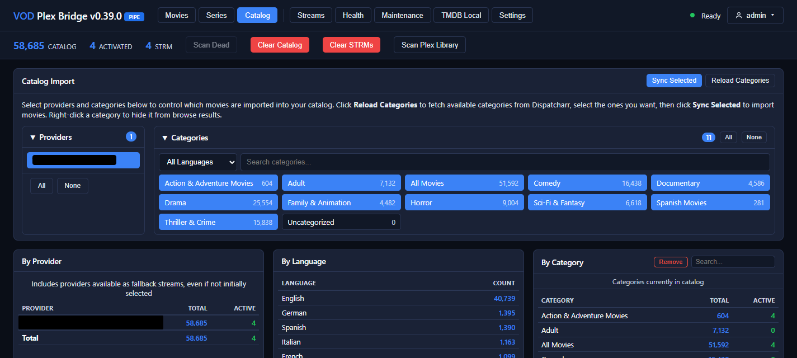

   TMDB details and language detection fill in afterwards, in the background.
2. Open the **Movies** tab and press **Activate** on a movie (or tick several and use the
   selection bar). It appears in Plex/Jellyfin within about a minute.

   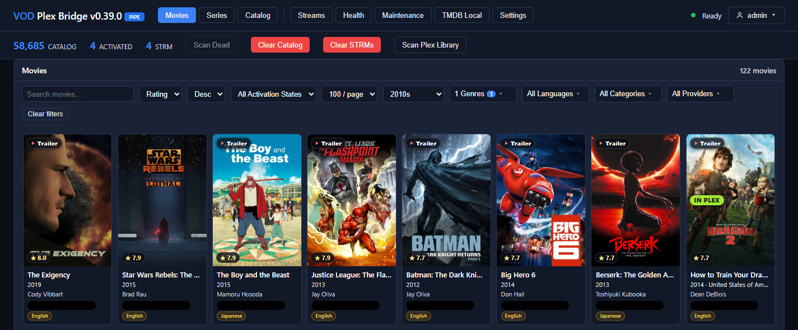

3. For TV, open the **Series** tab, tick the series categories, then activate a whole show,
   a season or single episodes.

   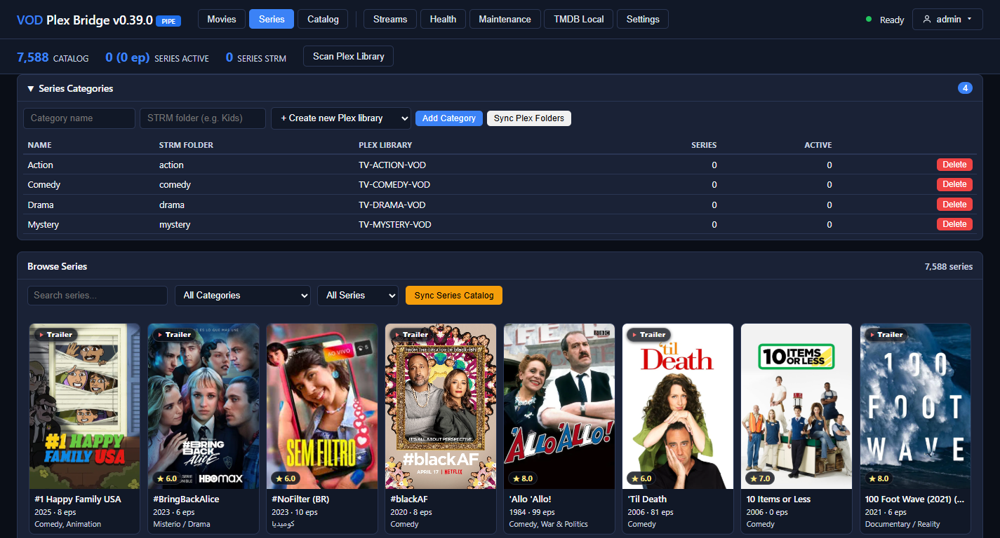

**Setup → 5. Done** turns green when every step above is green.

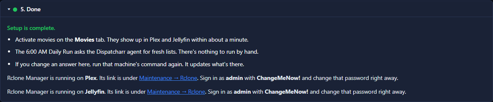

The [User Guide](docs/USER_GUIDE.md) explains every tab.

---

## Everyday use

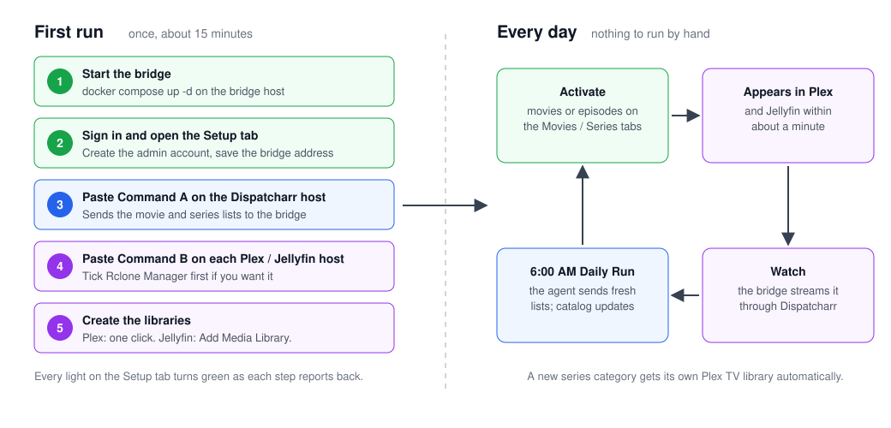

After setup you don't run anything by hand:

- **Activate** titles on the Movies and Series tabs. They show up in Plex/Jellyfin in about a
  minute.
- **The 6:00 AM Daily Run** asks the Dispatcharr agent for fresh lists, refreshes the catalog
  and removes titles that are gone from Dispatcharr. **Run Now** on the Daily Run tab does
  the same on demand.
- **Changed an answer** on a machine card (a folder, Docker, Rclone Manager)? Press **Save**
  and run that machine's command again.
- **Rclone Manager**, if you installed it, is at `http://<media-machine>:5573`, linked from the
  Health tab and Maintenance → Rclone. Without it, check the mounts with
  `systemctl status rclone-vod-bridge-movies` and restart them with
  `systemctl restart rclone-vod-bridge-movies rclone-vod-bridge-series`.
- **Regenerate** on the Setup tab makes a new private link. Commands you already copied stop
  working, so run Command A on the Dispatcharr machine again afterwards (and Command B, if you
  want to re-run it later).

## Prefer to see a script before you run it?

Every command has a **View the script** link. Or download it first and read it:

```bash
curl -fsSL -o media.sh http://192.168.1.20:8585/setup/<your-private-link>/media/m1.sh
less media.sh
sudo bash media.sh
```

To remove everything a command installed, add `--uninstall`:

```bash
curl -fsSL http://192.168.1.20:8585/setup/<your-private-link>/media/m1.sh | sudo bash -s -- --uninstall
```

On a media machine, uninstall stops and removes the two bridge mounts and their remotes (after
backing up `rclone.conf`). rclone itself, Rclone Manager, the empty mount folders and your
libraries stay. On the Dispatcharr machine it removes the agent and its schedule file. Other
rclone mounts and cron jobs are never touched.

---

## Platform notes

Only Linux / Proxmox LXC has a tested command. For the other choices, the machine card shows
filled-in steps, marked **untested**. What they cover:

**Unraid**
- Install the **rclone** plugin from Community Apps.
- Add a script in **Settings → User Scripts**, set to **At Startup of Array** and
  **Run in background**. The card gives you the script.
- Mount under `/mnt/addons/...`, never under `/mnt/user` (Unraid's share layer can't hold a
  FUSE mount).
- In the Plex/Jellyfin container template, add a path for the mount with access mode
  **Read/Write - Slave**.
- After a reboot the mount must be up before the container starts. If the library looks
  empty, restart the container.
- A Dispatcharr host on Unraid: `/etc/cron.d` doesn't survive a reboot, so schedule the agent
  with User Scripts instead.

**Windows**
- Install **WinFsp** and put `rclone.exe` in `C:\rclone\`.
- Create a task in **Task Scheduler → Create Task**, running at logon **as the user Plex runs
  as**, with **Run only when user is logged on**. Plex for Windows runs in that user's session
  and may not see a drive mounted by SYSTEM.
- The folders become drive letters, for example `V:\`. Use those in the library and in the
  bridge's mount-root settings.

**macOS**
- Install **FUSE-T** or **macFUSE**, and rclone from rclone.org (Homebrew's rclone can't
  mount).
- The card gives you a launchd plist for each mount. Save each one as the file named in its
  first line and load it with `launchctl load`.

**Synology / QNAP / other NAS**
- There's no host rclone. The card gives you a `vod-bridge-rclone` sidecar service (image
  `rclone/rclone`) that needs `/dev/fuse`, `cap_add: SYS_ADMIN` and an unconfined apparmor
  profile, and shares the mount with `rshared`.
- Make the folders on the NAS, add the service next to your media server, then give the
  Plex/Jellyfin container the volume lines with `rslave` and recreate it.

---

## Manual setup (advanced)

For anyone who would rather not pipe a script to bash. This is what the two commands do.

### Dispatcharr lists by hand

On the Dispatcharr machine, run the dump script from this repo with the bridge's data folder
as the output:

```bash
BRIDGE_DATA_DIR=/path/to/bridge/data bash setup/dump_mappings.sh
# More than one Dispatcharr container? Name it:
DISPATCHARR_CONTAINER=dispatcharr BRIDGE_DATA_DIR=/path/to/bridge/data bash setup/dump_mappings.sh
```

It writes five files: `stream_mapping.json`, `category_mapping.json`,
`series_category_mapping.json`, `movie_metadata.json` and `account_credentials.json`. If the
bridge runs on another machine, write them to a temp folder and copy them into the bridge's
`data/` folder.

Schedule it every 12 hours with `crontab -e`:

```bash
0 */12 * * * BRIDGE_DATA_DIR=/path/to/bridge/data bash /path/to/dump_mappings.sh >> /var/log/vod-bridge-dump.log 2>&1
```

For the Daily Run to get fresh lists on request, the bridge creates `.dump-trigger` in its data
folder and waits up to 3 minutes for `category_mapping.json` to change. A per-minute cron that
runs the dump when that file exists answers it. This only works when the data folder is on the
Dispatcharr machine, which is why Command A uses the bridge's API instead.

### rclone mount by hand

On the Plex/Jellyfin machine:

```bash
apt install fuse3
curl https://rclone.org/install.sh | sudo bash
sed -i 's/^#user_allow_other/user_allow_other/' /etc/fuse.conf

cat >> ~/.config/rclone/rclone.conf << 'EOF'
[vodbridge-movies]
type = http
url = http://BRIDGE_IP:8585/vod/

[vodbridge-series]
type = http
url = http://BRIDGE_IP:8585/vod-series/
EOF
```

`/etc/systemd/system/rclone-vod-bridge-movies.service`:

```ini
[Unit]
Description=VOD Plex Bridge movies mount
After=network-online.target
Wants=network-online.target

[Service]
Type=notify
ExecStartPre=/bin/mkdir -p /mnt/vod-bridge
ExecStart=/usr/bin/rclone mount vodbridge-movies: /mnt/vod-bridge --read-only --allow-other --dir-cache-time 1m --vfs-cache-mode full --vfs-cache-max-age 10m
ExecStop=/bin/fusermount -uz /mnt/vod-bridge
Restart=on-failure
RestartSec=10

[Install]
WantedBy=multi-user.target
```

Make the series unit the same way, with `vodbridge-series:` and `/mnt/vod-bridge-series`. Then
`systemctl daemon-reload && systemctl enable --now rclone-vod-bridge-movies rclone-vod-bridge-series`.

If you use different folders, set **Settings → Plex → Movie mount root / Series mount root** to
match, so the bridge tells Plex the right paths.

---

## Common layouts

| Layout | Bridge address | Command A runs on | Command B runs on |
|---|---|---|---|
| Everything on one machine | that machine | that machine | that machine |
| Bridge + Dispatcharr together, Plex separate | the shared machine | the shared machine | the Plex machine |
| Three separate machines | the bridge machine | the Dispatcharr machine | the Plex/Jellyfin machine(s) |
| Plex and Jellyfin on different machines | the bridge machine | the Dispatcharr machine | each media machine, one card each |

Command A sends its lists to the bridge over HTTP, so the bridge and Dispatcharr no longer have
to share a disk.

### Dispatcharr behind a VPN (gluetun)

Point **Settings → Dispatcharr** at the port that gluetun publishes on the host (for example
`http://192.168.1.20:9191`). The bridge does **not** need to be behind the VPN; all provider
traffic already goes Dispatcharr → VPN → provider. Command A works the same, because it reads
from the Dispatcharr container directly.

---

## Troubleshooting

**The Dispatcharr light never turns green**
- Did Command A finish with "All set"? Run it again and read its output.
- From the Dispatcharr machine, `curl http://BRIDGE_IP:8585/version` must answer. If it
  doesn't, check the bridge address in Setup step 1 and your firewall.
- Did you press **Regenerate**? Old commands stop working; copy Command A again.

**A machine's light never turns green**
- Run Command B again and read where it stops; each check says what to fix.
- "No /dev/fuse" in an LXC: see step 5.
- Wrong bridge address: it must be the LAN address, not `localhost`, `127.0.0.1` or `0.0.0.0`.
  Fix it in step 1, Save, and run the command again.

**The Daily Run report says "STALE dump"**
- The bridge asked for fresh lists and none arrived within 3 minutes. Check the Dispatcharr
  light, and that `/etc/cron.d/vod-plex-bridge` still exists on the Dispatcharr machine.

**Categories show 0 movies**
- No lists have arrived yet (Setup step 2 says "No lists received yet"), or no provider is
  ticked in the Catalog tab.

**The bridge can't reach Dispatcharr**
- Use **Settings → Dispatcharr → Test**. Use the LAN address, not `localhost`, unless the bridge
  uses `network_mode: host`.

**Plex/Jellyfin can't play a title**
- `ls /mnt/vod-bridge` on the media machine shows the file? If not, see "If a library looks
  wrong" in step 6.
- The title plays a short error card: it is down or busy at the provider. See the Dead Movies
  tab.
- It stops after about 10 minutes: Dispatcharr's nginx `/proxy/` location needs
  `uwsgi_buffering off` and `uwsgi_read_timeout 300s`.

**Mounts after a reboot**
- `systemctl status rclone-vod-bridge-movies`. If the bridge was down when the machine booted,
  the service retries every 10 seconds. A Docker media server started before the mount: restart
  the container.
