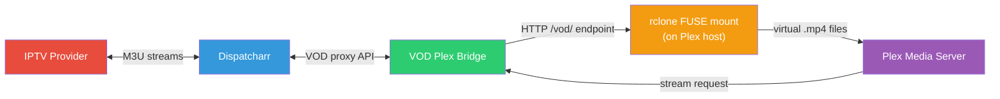
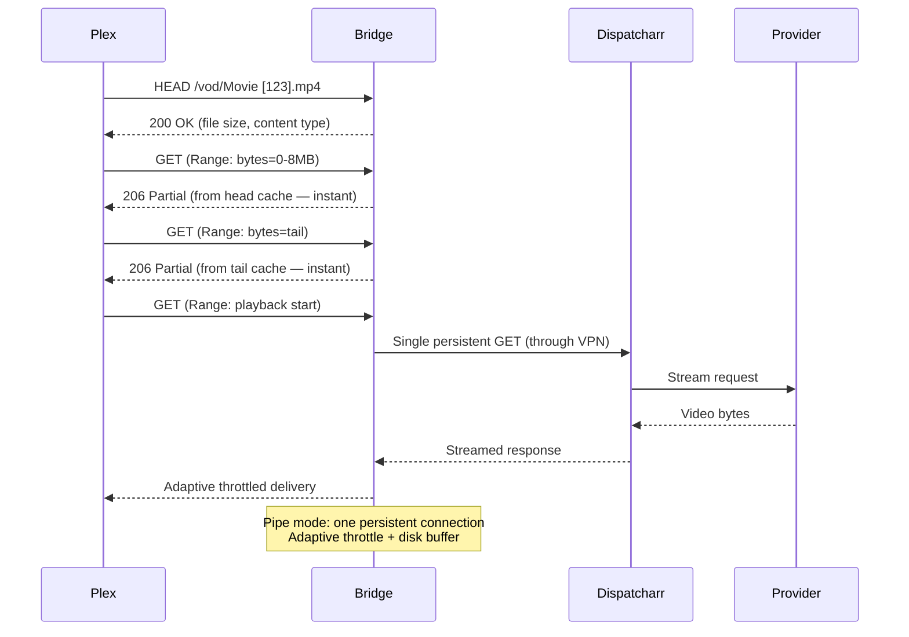
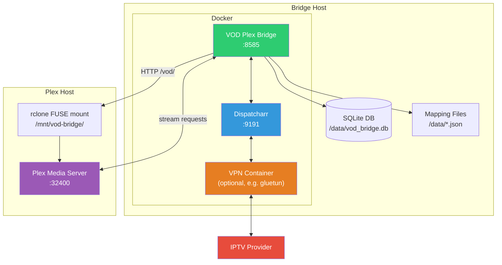
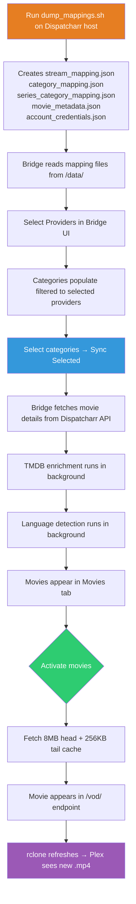

# VOD Plex Bridge

A self-hosted Docker application that bridges Video On Demand (VOD) content from [Dispatcharr](https://github.com/Dispatcharr/Dispatcharr) into [Plex Media Server](https://www.plex.tv/). Browse, activate, and stream VOD movies and TV series directly through the Plex interface — no manual file management required.

<!-- TODO: Add screenshot of the bridge UI here -->
<!--  -->

## How It Works

The bridge sits between Dispatcharr and Plex. It reads your VOD catalog from Dispatcharr, lets you pick which movies you want in Plex, and handles all the streaming plumbing automatically.



**Key points:**
- The bridge **never** connects directly to your IPTV provider — all traffic flows through Dispatcharr
- However Dispatcharr routes its traffic (VPN, direct, etc.), the bridge inherits that routing
- The bridge serves activated movies as virtual `.mp4` files via an HTTP endpoint (`/vod/`), and activated series episodes under `/vod-series/`
- **rclone** on the Plex host mounts this endpoint as a FUSE filesystem — Plex sees a normal directory of movie files
- No shared storage (NFS/CIFS) is required between the bridge and Plex — rclone handles it over HTTP

## Features

- **VOD Catalog Browser** — Browse and search your provider's movie catalog (Movies tab) with multi-select filters for language, category, genre, year, provider and activation state
- **TV Series** — Pick series categories, activate whole shows, seasons or single episodes, and send each category to its own Plex TV library
- **One-Click Activation** — Activate movies to instantly add them to your Plex library with poster art, genres, and metadata
- **Pipe Streaming** (default) — Single persistent connection to Dispatcharr with adaptive bitrate throttling and local disk buffering
- **Redirect Mode** (optional) — Sends Plex straight to Dispatcharr's VOD proxy with a 302, with a per-title session cap
- **Head/Tail Caching** — Caches the first 8 MB and last 256 KB of each activated movie so Plex can probe metadata without opening a provider connection
- **TMDB Enrichment** — Automatically fills in genres, descriptions, posters, runtime, director, country, and cast from [The Movie Database](https://www.themoviedb.org/), checking a local TMDB library first (TMDB Local tab) before calling the API
- **Multi-Provider Support** — Works with multiple M3U accounts, shows which providers carry each movie
- **Language Detection** — Background detection of audio language via TMDB, with filters in the browse UI
- **Plex Now Playing Dashboard** — Real-time view of all Plex sessions (bridge content and local/live TV) with codec, resolution, bandwidth, and transcode details
- **Health Dashboard** — Real-time status of Bridge, Dispatcharr, and Plex with response times
- **Daily Run** — Every day at 6am (plus a manual Run Now) the bridge refreshes mappings, categories and the catalog, enriches metadata and detects languages; each run's report is kept under Maintenance → Daily Updates
- **Settings in the App** — Dispatcharr instances, Plex, TMDB and streaming options are set in the Settings tab, with a Test button per service; secrets are stored encrypted
- **Sign-in** — The web UI requires an account, created on first start
- **Maintenance** — Dead movies, proxy log archives and run history in one tab
- **Dead Movie Tracking** — Automatically detects and removes movies no longer available from your provider
- **Persistent Buffers** — In pipe mode, downloaded data stays on disk between play sessions for resume
- **Error Screens** — When a movie can't play (dead, busy, removed), Plex shows a user-friendly video message instead of buffering
- **Activation Gating** — Only activated movies are visible to Plex. No mass scanning of your provider's catalog.

## How Streaming Works



The bridge maintains a single persistent connection to Dispatcharr per movie, with adaptive bitrate throttling and local disk buffering. Head/tail caches (8MB + 256KB) serve Plex's initial probing requests instantly with zero provider connections. Playback data is buffered to disk so Plex can read at its own pace.

## Architecture Overview



> **Note:** Dispatcharr and the bridge can run on the same host or different hosts. Plex can be anywhere on your network. The only requirements are: the bridge can reach Dispatcharr and Plex over the LAN, and the Plex host can reach the bridge's HTTP port (default 8585) for the rclone mount.

## Catalog Sync Flow



## Requirements

Before you start, you'll need:

| Requirement | Why | Notes |
|-------------|-----|-------|
| **[Dispatcharr](https://github.com/Dispatcharr/Dispatcharr)** | Manages your M3U accounts and proxies VOD streams | Must be running and accessible from the bridge |
| **[Plex Media Server](https://www.plex.tv/)** | Plays the movies | Must be able to reach the bridge over your LAN |
| **Docker + Docker Compose** | Runs the bridge | v20+ recommended |
| **Shell access to Dispatcharr host** | Run the dump script to extract mapping data | SSH or direct terminal |
| **[rclone](https://rclone.org/)** | Mounts the bridge's HTTP endpoint as a local directory on the Plex host | Install on the **Plex host**, not the bridge |
| **FUSE** | Required by rclone for filesystem mounting | `apt install fuse3` on the Plex host |
| **Dispatcharr API key** | The bridge reads the catalog through Dispatcharr's API | Create one in Dispatcharr; enter it in **Settings → Dispatcharr** |
| **TMDB API key** *(optional)* | Enriches metadata (posters, genres, descriptions) | Free at [themoviedb.org](https://www.themoviedb.org/settings/api) |

## Quick Start

See **[INSTALL.md](INSTALL.md)** for the full step-by-step guide with explanations. Once it's running, the **[User Guide](docs/USER_GUIDE.md)** covers every tab and setting. Release history is in **[CHANGELOG.md](CHANGELOG.md)**.

> **rclone is required.** Plex sees the bridge's movies and series only through an rclone mount on the Plex host, which you install and set up separately (Step 4 below). A future version will have rclone built in.

> **Dispatcharr, Plex and TMDB are set in the app.** After the first start, sign in (the first visit creates your account) and fill in **Settings**. Values in `.env` are only a starting point.

```bash
# 1. Clone and configure
git clone https://github.com/knmplace/vod-plex-bridge.git
cd vod-plex-bridge
cp .env.example .env          # Edit with your IPs, tokens, paths
cp docker-compose.example.yml docker-compose.yml

# 2. Build and start
docker compose up -d --build

# 3. Run the dump script on your Dispatcharr host
DISPATCHARR_CONTAINER=your-container-name \
BRIDGE_DATA_DIR=/path/to/bridge/data \
bash setup/dump_mappings.sh

# 4. Set up rclone on the Plex host (see INSTALL.md Step 7 for full details)
#    On the Plex server:
apt install rclone fuse3
mkdir -p /root/.config/rclone
cat > /root/.config/rclone/rclone.conf << EOF
[vodbridge]
type = http
url = http://BRIDGE_IP:8585/vod/

[vodbridgeseries]
type = http
url = http://BRIDGE_IP:8585/vod-series/
EOF
rclone mount vodbridge: /mnt/vod-bridge --allow-other --dir-cache-time 1m \
  --vfs-cache-mode full --vfs-cache-max-age 10m &
rclone mount vodbridgeseries: /mnt/vod-bridge-series --allow-other --dir-cache-time 1m \
  --vfs-cache-mode full --vfs-cache-max-age 10m &
#    (INSTALL.md Step 7 turns these into systemd services)

# 5. Add /mnt/vod-bridge as a Movies library in Plex
#    (and /mnt/vod-bridge-series as a TV Shows library if you use series)

# 6. Open http://your-bridge-ip:8585, create your account, fill in Settings,
#    then pick categories in the Catalog tab
```

## AI-Assisted Setup

If you use an AI coding assistant (Claude, ChatGPT, etc.), the repo includes **[BUILD_SOP.md](BUILD_SOP.md)** — a setup guide written to be dropped into an AI chat session. It walks through the same deployment steps in an interactive, question-and-answer format: the AI asks about your network layout, Dispatcharr location, Plex configuration, etc., and tailors the commands to your environment.

This guide was built from the steps the development team used to get the application running. It's provided as-is to help you get started — no guarantees that it covers every edge case or environment, but it can save time and help you avoid common pitfalls. If you run into issues, the [Troubleshooting](#troubleshooting) section and [INSTALL.md](INSTALL.md) are your best references.

## File Structure

```
vod-plex-bridge/
├── app/                      # Application source
│   ├── main.py               # FastAPI app, version, lifespan
│   ├── api.py                # REST API (catalog, activation, filters, Daily Run, series)
│   ├── auth.py               # Sign-in and sessions
│   ├── proxy.py              # Stream proxy (pipes, range requests, /vod/ and /vod-series/ listings)
│   ├── redirect.py           # Optional 302 redirect streaming mode
│   ├── cache.py              # Stream buffer cache
│   ├── scraper.py            # Movie catalog sync from Dispatcharr API
│   ├── series_scraper.py     # Series catalog sync
│   ├── generator.py          # Movie .strm / .nfo file generation
│   ├── series_generator.py   # Series / season / episode folders and NFOs
│   ├── database.py           # SQLite (WAL mode, singleton connection)
│   ├── stream_mapper.py      # Movie → provider stream ID mapping
│   ├── health.py             # Health check system
│   ├── error_screens.py      # Error video generation (Pillow + FFmpeg)
│   ├── config.py             # Environment defaults + values saved in Settings
│   ├── sources.py            # Dispatcharr instances and provider records (Settings)
│   ├── secret_box.py         # Encryption for saved secrets
│   ├── connection.py         # Plex connection test
│   ├── plex_libraries.py     # Plex library lookup / creation for series
│   ├── plex_presence.py      # "In Plex" detection
│   ├── tmdb_local.py, tmdb_store.py, tmdb_routes.py   # Local TMDB library
│   ├── assets/
│   │   └── bg.jpg            # Background image for error screens
│   └── templates/
│       └── index.html        # Single-page UI
├── setup/
│   └── dump_mappings.sh      # Dispatcharr data extraction script
├── docs/
│   └── USER_GUIDE.md         # How to use every tab and setting
├── Dockerfile
├── docker-compose.example.yml
├── .env.example
├── entrypoint.sh             # TZ configuration at startup
├── requirements.txt
├── INSTALL.md                # Detailed installation guide
├── BUILD_SOP.md              # AI-assisted setup guide
├── CHANGELOG.md              # Release history
└── README.md
```

## Configuration Reference

Most settings live in the app under **Settings** (one section per service, with a Test button
for each). They apply right away without a restart, except the redirect mode.

- **Plex, TMDB and streaming:** a value saved in Settings overrides `.env`; clearing it falls
  back to `.env`.
- **Dispatcharr:** on first start the `DISPATCHARR_*` values from `.env` become the primary
  instance in **Settings → Dispatcharr**. After that, the instance list is used and these
  variables are ignored.
- **Providers (XC):** read-only, a future feature. Provider logins belong in Dispatcharr; the
  bridge never contacts a provider.

API keys, tokens and passwords saved in Settings are encrypted in the database with
`SETTINGS_KEY` (or, when that is not set, a key file generated in the data folder).

| Variable | Required | Default | Description |
|----------|----------|---------|-------------|
| `DISPATCHARR_URL` | Yes* | `http://localhost:9191` | Dispatcharr URL reachable from the bridge container |
| `DISPATCHARR_API_KEY` | Yes* | — | Dispatcharr API key, sent with every catalog and stream call |
| `PLEX_URL` | Yes* | — | Plex server URL (e.g., `http://192.168.x.x:32400`) |
| `PLEX_TOKEN` | Yes* | — | Plex authentication token |
| `PLEX_LIBRARY_ID` | Yes* | `7` | Plex library section ID for VOD movies |
| `PLEX_SERIES_LIBRARY_ID` | No | — | Fallback Plex TV library for series categories without their own library |
| `PLEX_MOVIE_MOUNT_ROOT` | No | `/mnt/vod-bridge` | Where the movie rclone mount appears on the Plex host |
| `PLEX_SERIES_MOUNT_ROOT` | No | `/mnt/vod-bridge-series` | Where the series rclone mount appears on the Plex host |
| `BRIDGE_HOST` | Yes | `0.0.0.0` | LAN IP of the bridge host (written into .strm URLs) |
| `BRIDGE_PORT` | No | `8585` | Port the bridge listens on |
| `TZ` | No | `UTC` | Container timezone (e.g., `America/New_York`) |
| `TMDB_API_KEY` | No | — | TMDB API key for metadata enrichment |
| `TMDB_READ_TOKEN` | No | — | TMDB v4 read access token (alternative to API key) |
| `SETTINGS_KEY` | Recommended | — | Any long random string; encrypts secrets saved in Settings. Keep it safe: if lost, saved secrets must be re-entered |
| `DATA_DIR` | No | `./data` | Host path for database and mapping files |
| `PLEX_VOD_DIR` | No | `./plex-vod` | Host path for internal .strm/.nfo storage (Plex reads via rclone, not this path directly) |
| `STRM_SERIES_OUTPUT_DIR` | No | `/plex-vod/Series` | Path inside the container for series folders |
| `REDIRECT_MODE` | No | `false` | `true` sends Plex to Dispatcharr with a 302 instead of the pipe. Restart required |
| `MAX_CONCURRENT_PER_TITLE` | No | `2` | Session cap per title in redirect mode |

\* Required, but can be left out of `.env` and entered in **Settings** after the first start.

## Updating

```bash
cd vod-plex-bridge
git pull
docker compose up -d --build
```

Your database and settings persist in the `DATA_DIR` volume. The dump script keeps running on its own once the cron jobs from [INSTALL.md](INSTALL.md) Step 5 are in place.

## Troubleshooting

| Problem | Check |
|---------|-------|
| Bridge can't reach Dispatcharr | Verify `DISPATCHARR_URL` — use the LAN IP, not `localhost` (unless using `network_mode: host`) |
| Plex can't play movies | `BRIDGE_HOST` must be the LAN IP (not `0.0.0.0`). Verify rclone mount is active: `ls /mnt/vod-bridge/` on the Plex host |
| Movies in bridge but not Plex | Check rclone mount shows `.mp4` files (`ls /mnt/vod-bridge/`). Scan the library in Plex. Verify Plex library points to the rclone mount path |
| rclone mount is empty | No activated movies in the bridge, or bridge is unreachable. Test: `curl http://BRIDGE_IP:8585/vod/` |
| rclone mount hangs | Bridge is down. Check `docker ps` and `curl http://BRIDGE_IP:8585/version` from the Plex host |
| 0 categories showing | Run `setup/dump_mappings.sh` on the Dispatcharr host first. Select at least one provider. |
| Daily Run report says the dump is stale | The trigger cron on the Dispatcharr host isn't running, or the bridge data folder isn't on that host (INSTALL.md Step 5) |
| Every page sends you to sign-in | Expected: everything except the `/vod/`, `/vod-series/` and `/stream/` paths requires sign-in |
| Stream stops after ~10 min | Check Dispatcharr nginx has `uwsgi_buffering off` and `uwsgi_read_timeout 300s` on the `/proxy/` location |
| "Database is locked" | Should not occur in current versions. Restart the container if it does. |

## License

MIT
